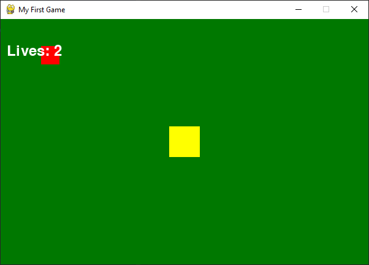

# python-games

Three beginner games I built while learning Python.

## 1. Number Guessing Game (`guess_game.py`)
The computer picks a secret number from 1 to 10. You get 3 tries, with "too high" and "too low" hints. It does not crash if you type a word instead of a number.

## 2. Rock, Paper, Scissors (`rps_game.py`)
Play 5 rounds against the computer. It keeps score and announces the winner.

## 3. Catch Game (`catch_game.py`)
A Pygame game. Move the yellow square with the arrow keys and catch the falling red blocks. You have 3 lives, and the blocks fall faster every 5 points.

## How to run
1. Install Python from python.org
2. Install Pygame: `pip install pygame`
3. Run any file, for example `python catch_game.py`

## What I learned
I learned to test every path in a program, not only the first result that looks right. In Rock, Paper, Scissors, the score was wrong because two of the winning rules never added a point, and I only found it by counting my wins on the screen. In the Pygame game, I learned how a game loop works: check the player's input, update positions, then draw, about 60 times a second.

## Tools used
Python, Pygame
